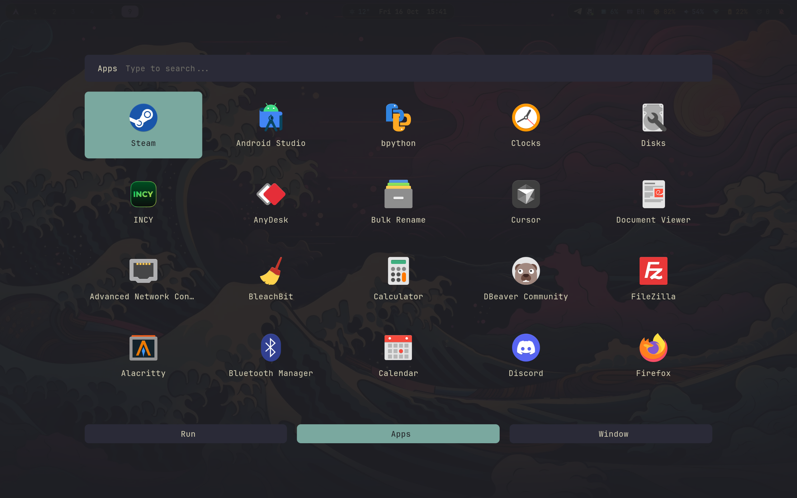
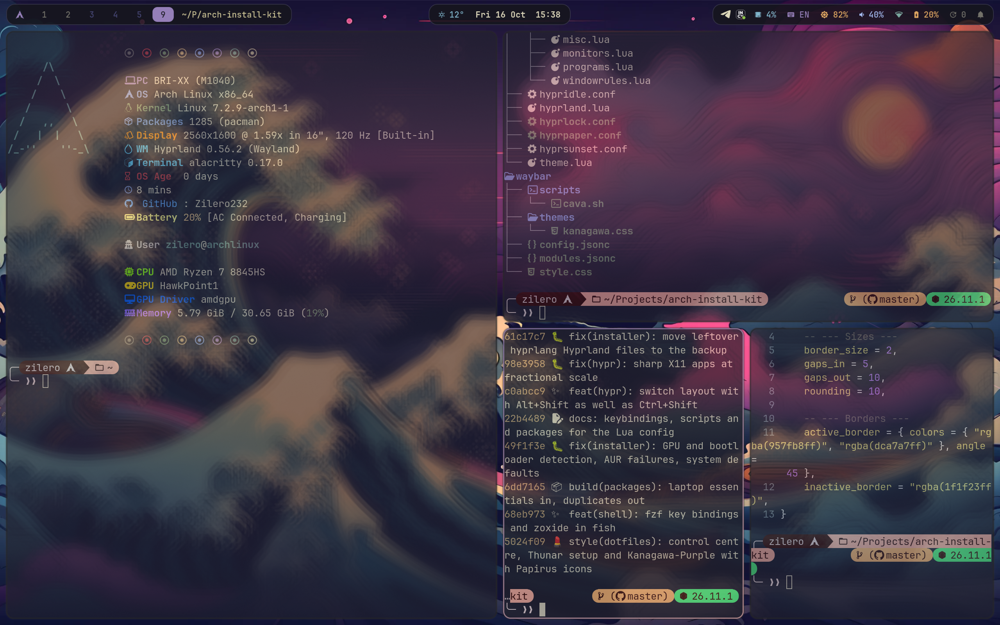
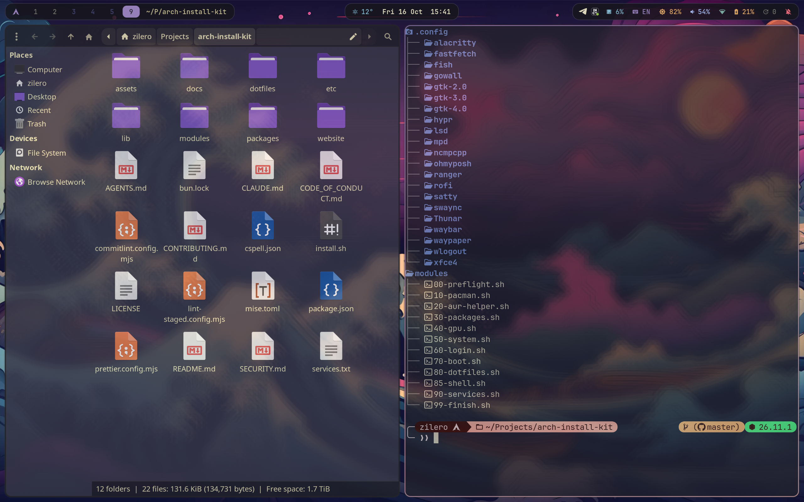
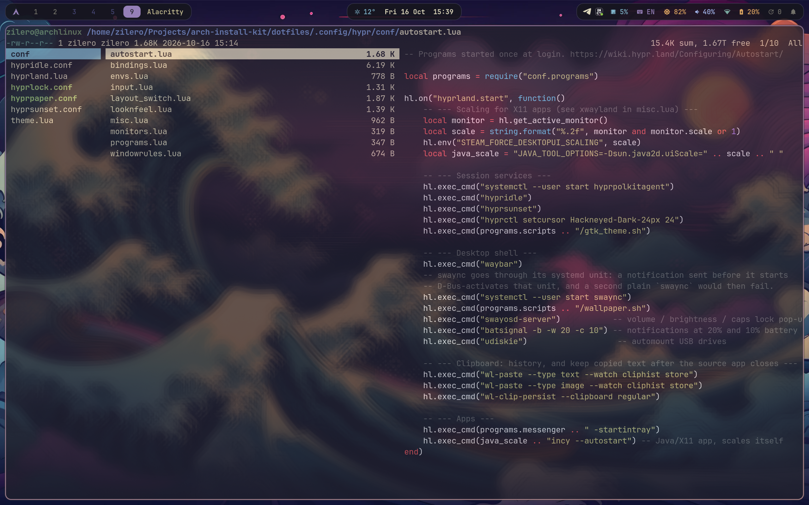
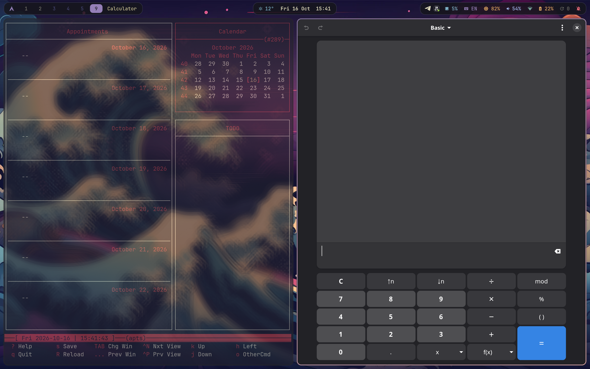
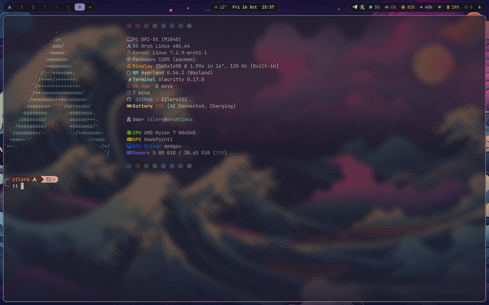
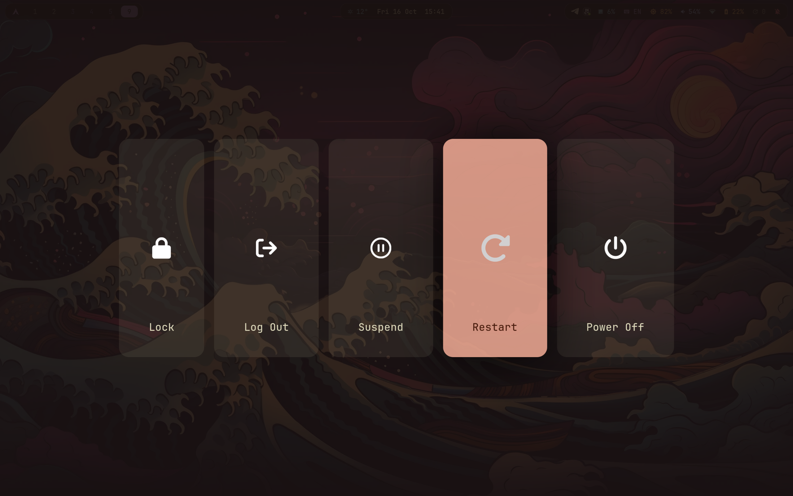

<div align="center">

# Arch Install Kit

**A Hyprland setup for Arch Linux that installs with a single command**

### [🌊 zilero232.github.io/arch-install-kit](https://zilero232.github.io/arch-install-kit/)

The website has the full step-by-step guide, keybindings and search.

[](https://archlinux.org)
[](https://hypr.land)
[](https://github.com/Alexays/Waybar)
[](https://fishshell.com)

[](https://github.com/Zilero232/arch-install-kit/commits/master)
[](https://github.com/Zilero232/arch-install-kit/stargazers)
[](./LICENSE)
[](https://zilero232.github.io/arch-install-kit/)


</div>

## ⚡ Quick start

On a fresh Arch install (archinstall, **Minimal** profile), as your regular user:

```bash
sudo pacman -S --needed git
git clone https://github.com/Zilero232/arch-install-kit.git ~/arch-install-kit
cd ~/arch-install-kit
./install.sh
```

The script installs packages and drivers, deploys the configs, and sets up boot and services. Reboot and you're in Hyprland.

No Arch yet? Start with the [step-by-step guide](./docs/README.md): from a USB stick to a ready-to-use desktop.

## ✨ What's inside

|                  |                                                                                                         |
| ---------------- | ------------------------------------------------------------------------------------------------------- |
| 🪟 Compositor    | [Hyprland](https://hypr.land) + hyprlock, hypridle, hyprpaper, hyprsunset                               |
| 📊 Bar           | [Waybar](https://github.com/Alexays/Waybar): weather, updates, audio visualizer                         |
| 🚀 Launcher      | [Rofi](https://github.com/davatorium/rofi): apps, calculator, emoji, clipboard history                  |
| 🔔 Notifications | [SwayNC](https://github.com/ErikReider/SwayNotificationCenter)                                          |
| 📟 Terminal      | [Alacritty](https://alacritty.org) + [Fish](https://fishshell.com) + [Oh My Posh](https://ohmyposh.dev) |
| 📂 Files         | Thunar, Ranger                                                                                          |
| 🎨 Theme         | Kanagawa (GTK, icons, terminal, bar), Hackneyed cursor                                                  |
| 🔐 Login         | SDDM Astronaut, Plymouth splash                                                                         |
| 🖼️ Wallpapers    | Wallpaper Engine or 270+ static ones from `assets/images`                                               |

## 🛠️ Installer

```text
./install.sh                 everything: desktop + apps
./install.sh --minimal       desktop only
./install.sh --groups dev    desktop + chosen groups
./install.sh --only dotfiles update configs only
./install.sh --link          symlink configs to the repo
./install.sh --dry-run       show the plan without changing anything
```

- **Modular:** every step is its own file in [`modules/`](./modules), and any of them can be run on its own.
- **Safe:** re-running breaks nothing, and replaced files get backed up.
- **Picks drivers for you:** Intel, AMD, NVIDIA, CPU microcode.
- **Packages** are plain per-group lists in [`packages/`](./packages).

More: [running and options](./docs/install/04-run-installer.md) · [how it works](./docs/reference/structure.md).

## 📸 Screenshots

<details>
<summary>Show</summary>

|                                                           |                                                           |
| --------------------------------------------------------- | --------------------------------------------------------- |
|         |      |
|   |           |
|       |  |
|  |       |

</details>

## 📚 Documentation

Best read on the [website](https://zilero232.github.io/arch-install-kit/) (search, dark theme, sidebar). The same pages live in [`docs/`](./docs):

- [Step-by-step install](./docs/README.md#installation--step-by-step) — backup, USB stick, archinstall, install.sh
- [Keybindings](./docs/usage/keybindings.md)
- [Packages](./docs/reference/packages.md)
- [When something breaks](./docs/reference/troubleshooting.md)

## 🤝 Contributing

Guidelines, code style and commit format live in [CONTRIBUTING.md](./CONTRIBUTING.md).

## 👤 Author

**Artemev Alexandr** — [GitHub](https://github.com/Zilero232) · [Habr Career](https://career.habr.com/zilero)

Licensed under [MIT](./LICENSE).
