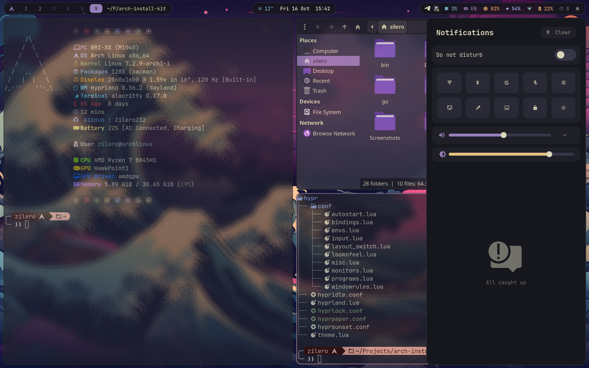

<div align="center">


# Arch Install Kit

**From a blank Arch install to a finished Hyprland desktop with one script.**<br />
My own Kanagawa-themed setup: a modular installer you can re-run, preview with `--dry-run` and undo.

[Website](https://zilero232.github.io/arch-install-kit/) · [Install guide](https://zilero232.github.io/arch-install-kit/install/01-backup) · [Keybindings](https://zilero232.github.io/arch-install-kit/usage/keybindings) · [Troubleshooting](https://zilero232.github.io/arch-install-kit/reference/troubleshooting)

[](https://github.com/Zilero232/arch-install-kit/actions/workflows/test.yml)
[](https://github.com/Zilero232/arch-install-kit/commits/master)
[](./LICENSE)



</div>

## ✨ Features

- **One command, re-runnable.** `./install.sh` installs packages, drivers and configs, then boot and services. Run it again and nothing breaks; run a single step with `--only`.
- **See before you change.** `--dry-run` prints every command that would touch the system. An edited `/etc` file is backed up before the first change, replaced configs go to `~/.config-backup/`.
- **Drivers picked for you.** Intel, AMD or NVIDIA (hybrid laptops too) and CPU microcode, installed before anything that needs a Vulkan driver.
- **A complete desktop.** Hyprland with lock, idle and night light; Waybar with weather, updates and an audio visualizer; Rofi for apps, emoji, calculator and clipboard history; SwayNC with quick toggles.
- **One palette everywhere.** Kanagawa in Waybar, GTK, the terminal, Rofi, the lock screen and the login screen, kept in one file.
- **Laptop-ready.** Power profiles, battery alerts, zram swap, sleep on battery, a snapshot before every system upgrade (Timeshift), firewall on.
- **Pick what you need.** Core groups always; apps, dev, media, office and gaming on request. The lists are plain text in [`installer/packages/`](./installer/packages).
- **Tested.** ShellCheck, bats and config tests on every push, plus a real Arch container that runs the dry run and checks every package exists.

## 📸 Screenshots

| Launcher                                                           | Waybar                                                      |
| ------------------------------------------------------------------ | ----------------------------------------------------------- |
|      |  |
| **Terminals**                                                      | **Power menu**                                              |
|  |         |

<details>
<summary>More</summary>

| Files                                                     | Ranger                                                    |
| --------------------------------------------------------- | --------------------------------------------------------- |
|          |       |
| **Calendar and calculator**                               | **System info**                                           |
|  |  |

</details>

## 📋 Requirements

- A **UEFI** x86_64 PC, Secure Boot off.
- Arch Linux installed with archinstall's **Minimal** profile (or an existing Arch install), a regular user with sudo, internet.
- Tested on an AMD Ryzen 7 8845HS / Radeon 780M laptop. Intel and NVIDIA are detected and get their drivers, but are less tested.
- About 100 MB to download with `--depth 1`, mostly the 373 wallpapers (WebP).
- Keeping Windows? Read [dual boot](./docs/install/03-archinstall.md#option-c-next-to-windows-dual-boot) **before** you partition: archinstall's default layout wipes the whole disk. Adding Windows to an installed Arch: [Dual boot with Windows](./docs/usage/dual-boot.md).

## ⚡ Quick start

As your regular user, not root:

```bash
sudo pacman -S --needed git
git clone --depth 1 https://github.com/Zilero232/arch-install-kit.git ~/arch-install-kit
cd ~/arch-install-kit
./install.sh --dry-run   # see the plan, change nothing
./install.sh             # pick groups, confirm, wait
```

Reboot and log in to Hyprland. No Arch yet? The [step-by-step guide](./docs/README.md) goes from the USB stick to the desktop.

> Some defaults are mine: the `ru_RU` locale, the Wi-Fi region (`RU`) and the mirror countries. Change them first, see [running install.sh](./docs/install/04-run-installer.md).

## ⌨️ First keys

| Keys            | Action                       |
| --------------- | ---------------------------- |
| `Super + Enter` | terminal                     |
| `Super + D`     | app launcher                 |
| `Super + Q`     | close window                 |
| `Super + /`     | every keybinding, searchable |
| `Super + L`     | lock screen                  |
| `Super + X`     | power menu                   |

All of them: [keybindings](./docs/usage/keybindings.md).

## 🛠️ Installer

```text
./install.sh                     desktop + the optional groups you pick
./install.sh --minimal           core groups only
./install.sh --groups dev,gaming core groups + the listed ones
./install.sh --only dotfiles     run only these steps
./install.sh --skip packages     run everything but these steps
./install.sh --link              symlink configs to the repo instead of copying
./install.sh --no-plymouth       no boot splash
./install.sh --dry-run           print what would change, change nothing
./install.sh --yes               no questions
```

Every step is one file in [`installer/modules/`](./installer/modules). How it works: [repository structure](./docs/reference/structure.md).

## 🔄 Update and roll back

```bash
cd ~/arch-install-kit && git pull
./install.sh --only dotfiles   # new configs (yours go to ~/.config-backup/ first)
yay                            # system update; Timeshift takes a snapshot before it
```

To undo: system files have a `.kit.bak` copy next to them, replaced configs are in `~/.config-backup/<date>/`, and Timeshift restores the whole system. Details: [rolling back](./docs/reference/troubleshooting.md#rolling-back).

## 🙏 Credits

- [Kanagawa](https://github.com/rebelot/kanagawa.nvim) by rebelot: the palette; [Kanagawa GTK](https://github.com/Fausto-Korpsvart/Kanagawa-GKT-Theme) by Fausto-Korpsvart.
- [SDDM Astronaut](https://github.com/Keyitdev/sddm-astronaut-theme) by Keyitdev: the login screen.
- [Papirus](https://github.com/PapirusDevelopmentTeam/papirus-icon-theme) icons, [Hackneyed](https://gitlab.com/Enthymeme/hackneyed-x11-cursors) cursor, the [Arch logo](https://www.gnome-look.org/content/show.php/Arch-logo+plymouth?content=141697) Plymouth theme.
- [Hyprland](https://hypr.land) and everyone behind the tools in the package lists.
- The wallpapers in `assets/images/` belong to their authors and are not covered by this repo's license.

## 📄 License

[MIT](./LICENSE), by **Artemev Alexandr** ([GitHub](https://github.com/Zilero232) · [Habr Career](https://career.habr.com/zilero)). Contributions: [CONTRIBUTING.md](./.github/CONTRIBUTING.md).
